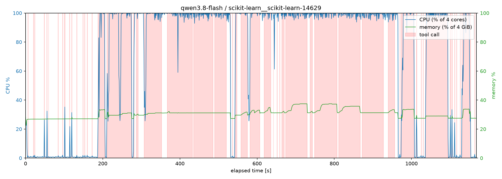
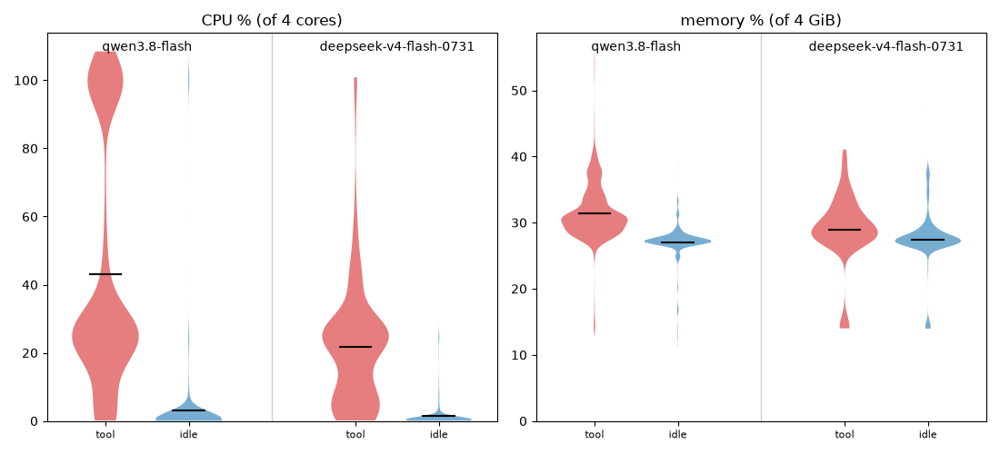
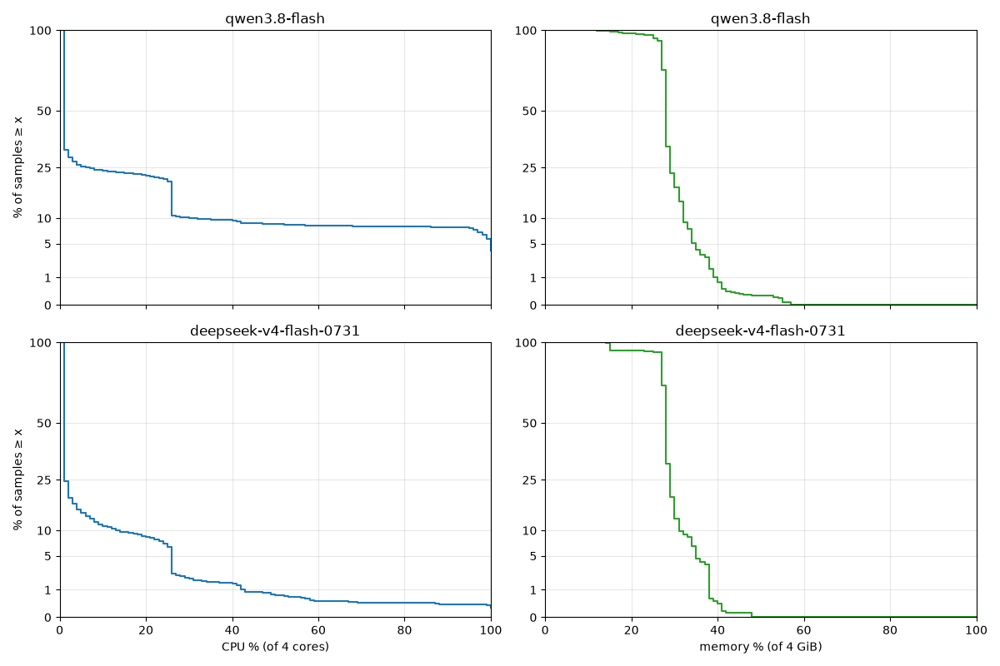

# Agent System Metrics Benchmark

Benchmark of agent runtime resource use (CPU/RAM). Measures Python coding agents on Daytona sandboxes. Output: data for CPU/RAM allocation.

## Conditions

- Tasks: 20 SWE-bench Verified Python tasks (config `default`, split `test`; seed 42, round-robin by repo; only <1h-rated, Docker Hub image ≤2 GB).
- Models: Qwen3.8 Flash + DeepSeek V4 Flash → matrix 20 × 2 = 40 runs, 1 run/task/model, no reruns.
- Sandbox: 4 vCPU / 4 GiB / 10 GiB disk.
- Concurrency: 2 sandboxes (`BATCH_SIZE`). Sampling: 1s. Run cap: 45 min, censored if hit.
- Cleanup: export artifacts, then delete sandbox.

## Tools

- mini-SWE-agent 2.4.6 — in-sandbox `/opt/minisweagent`, `local` mode, no nested Docker
- Daytona Cloud — sandbox runner/profiler
- Python + uv — `benchmark.py` (matrix runner), `build_dataset.py` (dataset builder)
- cgroup v2 collector — `metrics.sh` (1s sampling)

## Config

Env vars only (copy `.env.example` to `.env`, export it):

| Variable | Meaning |
|---|---|
| `DATASET_PATH` | Dataset CSV; default `./data/sample20.csv`. All rows × all models run. |
| `BATCH_SIZE` | Concurrent sandboxes; default `2`. |
| `DAYTONA_API_KEY` | Required; runner fails before creating sandboxes if missing. |
| `QWEN_TOKEN_PLAN_API_KEY` | Required; provisions Daytona secret `qwen-token-plan` → sandbox env `OPENAI_API_KEY`, host allowlist `token-plan.ap-southeast-1.maas.aliyuncs.com`. |

## Run

```bash
set -a; . ./.env; set +a   # export .env
uv run python benchmark.py
```

Rebuild dataset: `uv run python build_dataset.py`.

Artifacts: `runs/<model>/<instance_id>/` — `install.log`, `agent.log`, `trajectory.traj.json`, `patch.diff`, `metrics.jsonl`, `status.json`.
Exit code: `0` all runs OK; `1` any fail/censor/cleanup fail. No resume; rerun overwrites.

### Local Docker, one container per bash call (opencode and mini-swe-agent)

```bash
set -a; . ./.env; set +a   # needs QWEN_TOKEN_PLAN_API_KEY
uv run python local_benchmark.py opencode   # or: miniswe. Needs Docker running.
```

Same tasks, models and Qwen token plan as `benchmark.py`; only the agent differs, everything else is shared code.

- Harness: one container per task from `harness.Dockerfile` (both agents, built once; versions passed from `local_benchmark.py`), 1 vCPU / 2 GiB, no swap.
  - opencode 1.19.2: provider `qwen-token-plan` in `opencode.json`, which denies every tool but bash (hiding them from the model) and sets opencode's `shell` to the tool client.
  - mini-swe-agent 2.4.6: `benchmark.py`'s config, with `environment_class: mini_env.ToolContainerEnvironment` (`mini_env.py`), its local environment with every command sent to the tool client. Timeout (60 s), output and submission handling stay mini-swe-agent's.
- Tools: `tool_client.py`, installed as `/opt/hook/bin/bash`, gets `bash -c <command>` from either agent, untouched, so the model's history shows what it typed (an earlier version rewrote commands in an opencode plugin, and the model started imitating the rewritten form). It forwards each command to a tool server in the runner (via `host.docker.internal`), which runs it with `docker run --rm` from the task image, 1 vCPU / 1 GiB, no swap. If the agent's own command timeout kills the client, the server kills the container too.
- State: one named volume per task holds `/testbed`, seeded by Docker from the task image and mounted by the harness and every tool container. Nothing to sync; only state outside `/testbed` (pip installs, `/tmp`) is lost between calls.
- Concurrency: `BATCH_SIZE` default 2, bounded by the machine (the published runs used 8). `MODELS=a,b` limits the models, e.g. to rerun some tasks with `DATASET_PATH`.
- Artifacts: `runs/<agent>-<model>/<instance_id>/`, as above plus `toolcalls.jsonl` (per call: `docker run` wall time, exit code, `exec_start`/`exec_end`, whole-container CPU µs and memory peak) and `toolmetrics.jsonl` (`metrics.sh` 1s samples of every tool container, tagged with `call`). `metrics.jsonl` covers the harness only; `agent.log` is opencode's JSON event stream or mini-swe-agent's output, and mini-swe-agent also exports `trajectory.traj.json`; `install.log` covers the image pull and volume seed.
- Charts: `charts/session_grid.py --agent opencode|miniswe|miniswe-daytona` (task × model grid), `charts/session_chart.py runs/<agent>-<model>/<task>` (one session).

## Results

- [qwen3.8-flash scikit-learn__scikit-learn-14629 task profile](images/qwen3.8-flash-scikit-learn__scikit-learn-14629.png) (see [all tasks](images/compare-grid.png)) 
- [usage boxplot](images/usage-boxplot.png) 
- [tool binding](images/tool-binding.png) 
- [tool gaps](images/tool-gaps.png) 
- [usage ccdf](images/usage-ccdf.png) 