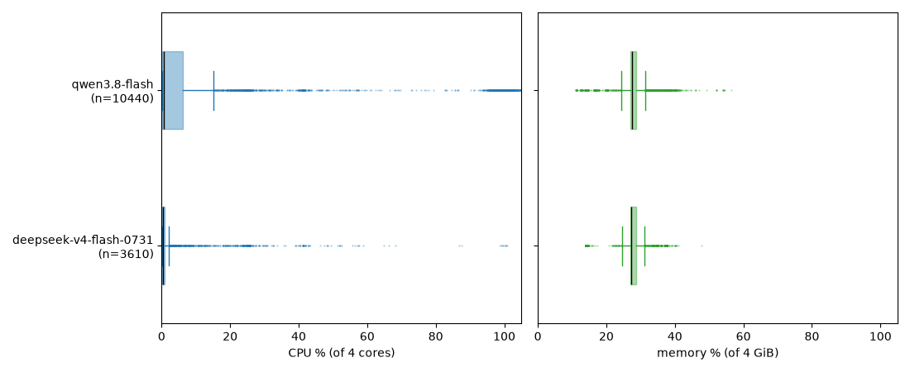
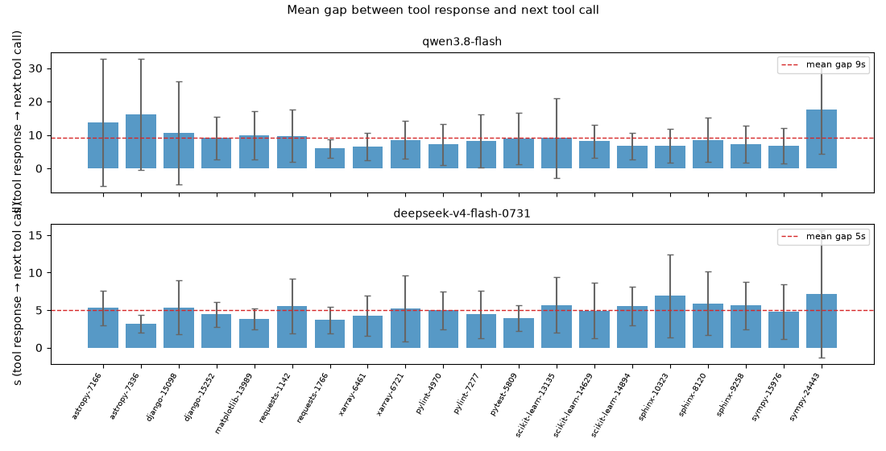

# Experiment 1: mini-swe-agent, whole-sandbox system metrics (Daytona)

One Daytona sandbox per task, from the task image: 4 vCPU / 4 GiB / 10 GiB disk. mini-swe-agent 2.4.6 is installed in `/opt/minisweagent` and runs its commands in `local` mode, with no nested Docker. `shared/metrics.sh` samples the whole sandbox cgroup, so agent and tool CPU/RAM are measured together. Tool-call windows come from the trajectory's timestamps.

- Concurrency: 2 sandboxes. The Daytona org caps total concurrent use at 10 vCPU / 10 GiB, which is why memory is 4 GiB: RAM demand above 4 GiB is censored and shows only as OOM counters.
- `QWEN_TOKEN_PLAN_API_KEY` is provisioned as the Daytona secret `qwen-token-plan` → sandbox env `OPENAI_API_KEY`, host allowlist `token-plan.ap-southeast-1.maas.aliyuncs.com`.
- Cleanup: export artifacts, then delete the sandbox.

Uses from `shared/`: `runner.py` (dataset, pool, status, mini-swe-agent config), `metrics.sh`, `plot.py`, `dataset/sample20.csv`.

## Run

```bash
uv run python -m miniswe_daytona.benchmark     # from the repo root; needs DAYTONA_API_KEY
```

Artifacts: `runs/<model>/<instance_id>/`: `install.log`, `agent.log`, `trajectory.traj.json`, `patch.diff`, `metrics.jsonl` (whole sandbox, from create to delete), `status.json`.

## Charts

```bash
uv run python -m miniswe_daytona.charts.task_chart miniswe_daytona/runs/qwen3.8-flash/astropy__astropy-7166
uv run python -m miniswe_daytona.charts.compare_grid   # task × model grid
uv run python -m miniswe_daytona.charts.model_boxplot  # CPU/RAM distribution per model
uv run python -m miniswe_daytona.charts.model_ccdf     # % of samples needing ≥ x % of the allocation
uv run python -m miniswe_daytona.charts.tool_binding   # usage inside vs outside tool calls
uv run python -m miniswe_daytona.charts.tool_gaps      # time between a tool response and the next call
```

## Results

- [qwen3.8-flash scikit-learn__scikit-learn-14629 task profile](images/qwen3.8-flash-scikit-learn__scikit-learn-14629.png) (see [all tasks](images/compare-grid.png)) 
- [usage boxplot](images/usage-boxplot.png) 
- [tool binding](images/tool-binding.png) 
- [tool gaps](images/tool-gaps.png) 
- [usage ccdf](images/usage-ccdf.png) 
