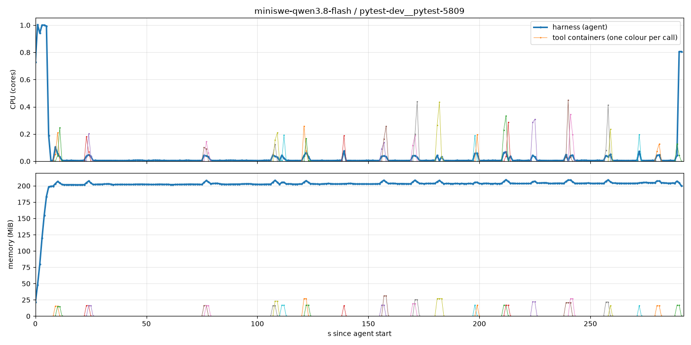

# Experiment 3: mini-swe-agent, per-tool system metrics (local Docker)

mini-swe-agent 2.4.6 in the [local harness](../local_harness/README.md): every bash call runs in its own container, so agent and tool CPU/RAM are measured separately. The agent config is experiment 1's (`shared/runner.py` `make_agent_config`), so this run is directly comparable to [experiment 1](../miniswe_daytona/README.md).

Specific to this experiment: `mini_env.py`. It sets `environment_class: mini_env.ToolContainerEnvironment`, mini-swe-agent's local environment with every command sent to the tool client. The 60 s timeout, output handling and submission handling stay mini-swe-agent's own.

Shared: `local_harness/` (runner, harness image, tool client, charts) and `shared/` (dataset, pool, status, mini-swe-agent config, `metrics.sh`).

## Run

```bash
uv run python -m local_harness.local_benchmark miniswe   # from the repo root; Docker running
```

Artifacts: `runs/<model>/<instance_id>/` (see the [local harness](../local_harness/README.md#artifacts)), plus `trajectory.traj.json`. `agent.log` is mini-swe-agent's output. `runs/full.log` holds the matrix summary.

## Results

- [qwen3.8-flash pytest-dev__pytest-5809 session](images/qwen3.8-flash-pytest-dev__pytest-5809.png) 
- [all tasks](images/compare-grid.png)
