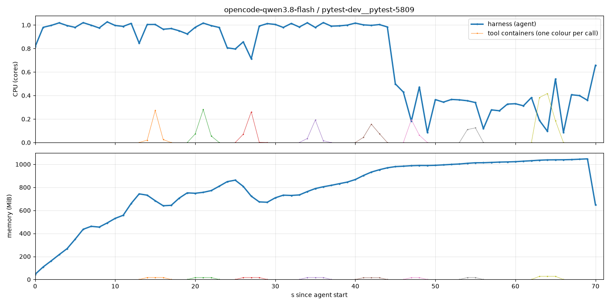

# Experiment 2: opencode, per-tool system metrics (local Docker)

opencode 1.19.2 in the [local harness](../local_harness/README.md): every bash call runs in its own container, so agent and tool CPU/RAM are measured separately.

Specific to this experiment: `opencode.json`. It defines the provider `qwen-token-plan` (same token plan as experiment 1), denies every tool but bash so the model never sees the others, and sets opencode's `shell` to the tool client.

Shared: `local_harness/` (runner, harness image, tool client, charts) and `shared/` (dataset, pool, status, `metrics.sh`).

## Run

```bash
uv run python -m local_harness.local_benchmark opencode   # from the repo root; Docker running
```

Artifacts: `runs/<model>/<instance_id>/` (see the [local harness](../local_harness/README.md#artifacts)). `agent.log` is opencode's JSON event stream (`--format json`), which also serves as the trajectory. `runs/full.log` holds the matrix summary.

## Results

- [qwen3.8-flash pytest-dev__pytest-5809 session](images/qwen3.8-flash-pytest-dev__pytest-5809.png) 
- [all tasks](images/compare-grid.png)
